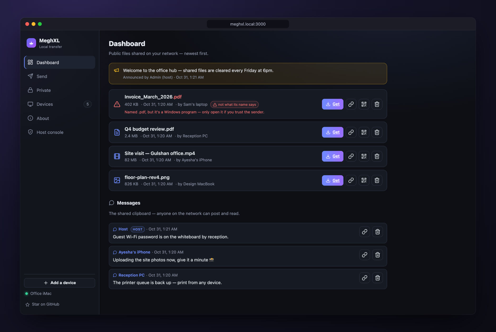
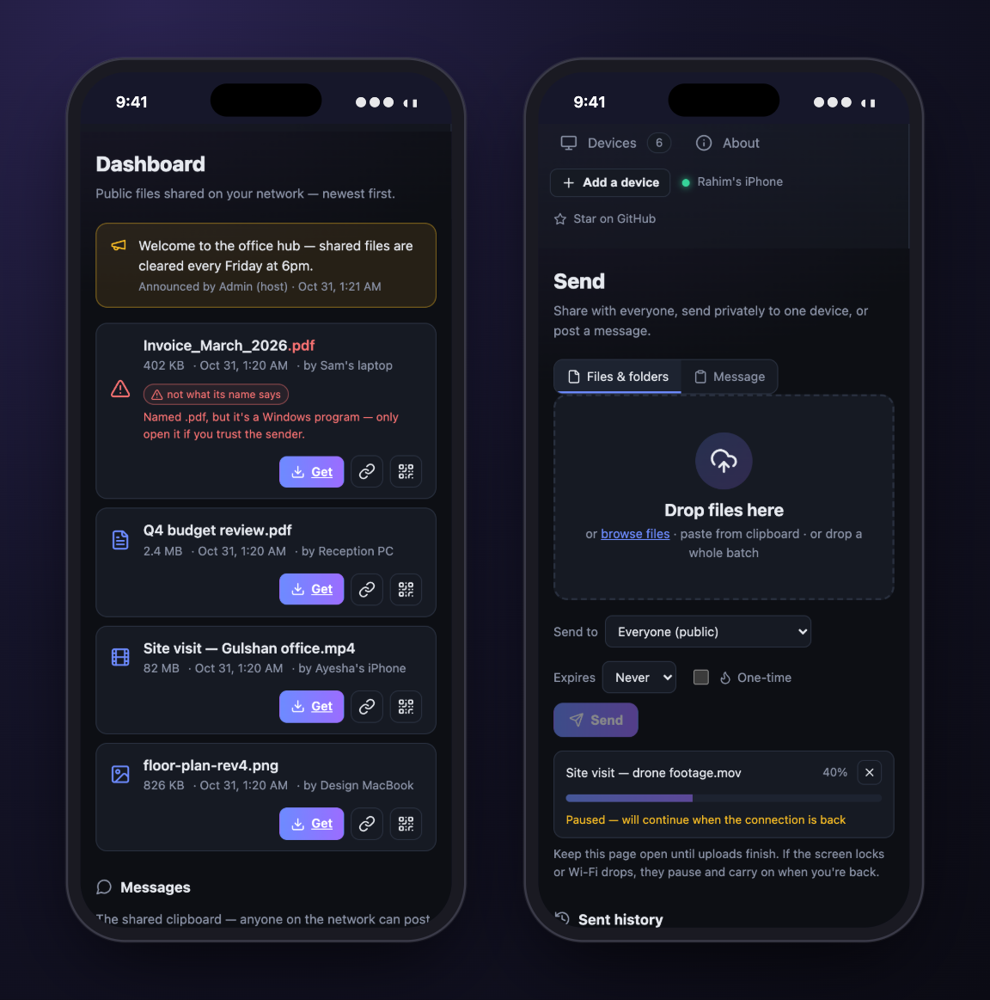
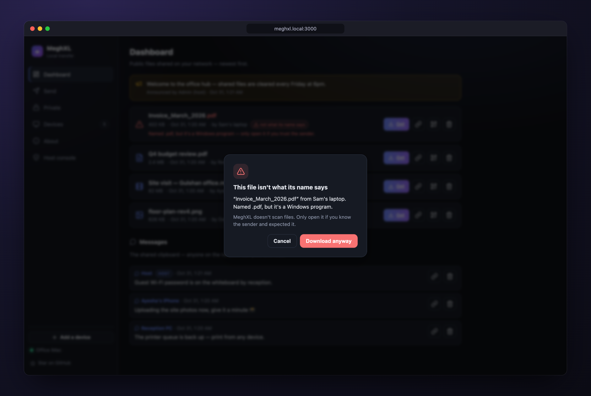
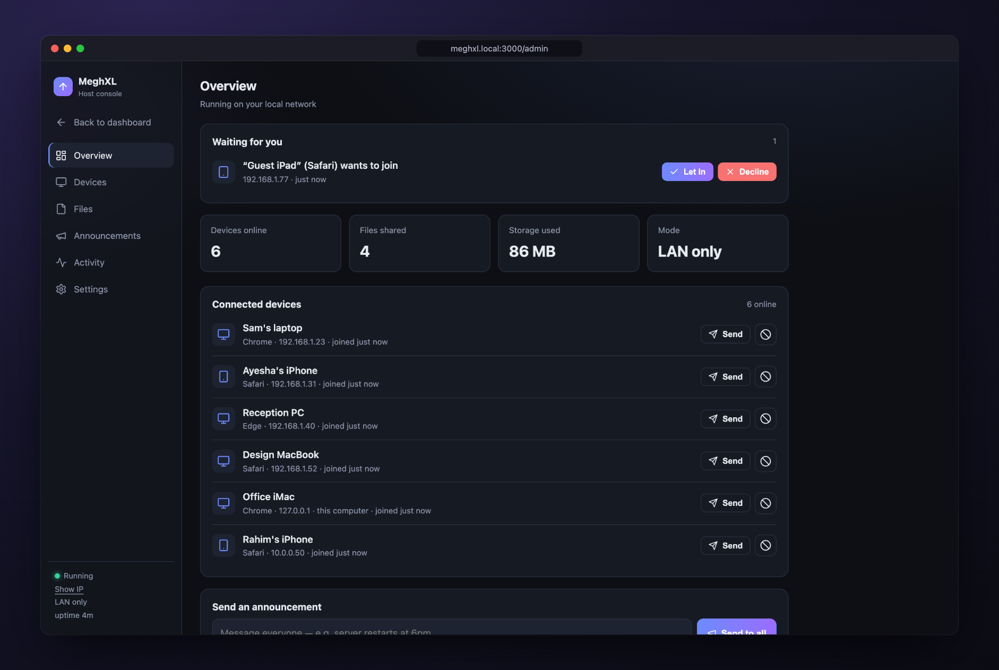
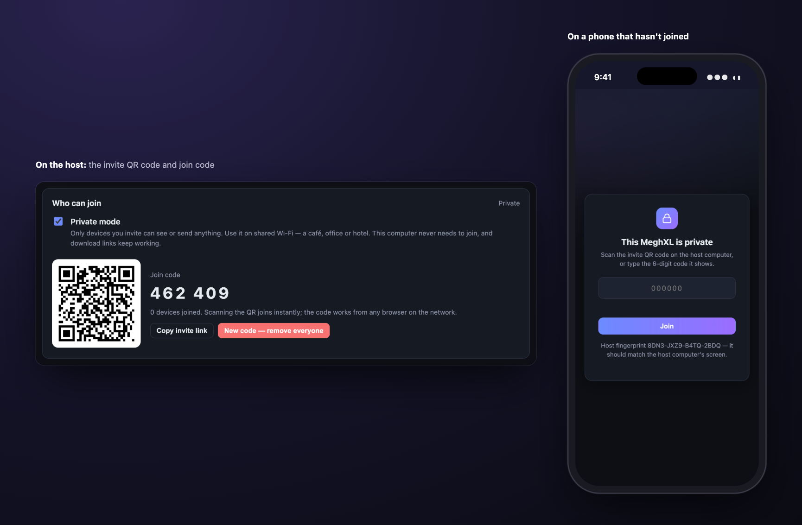
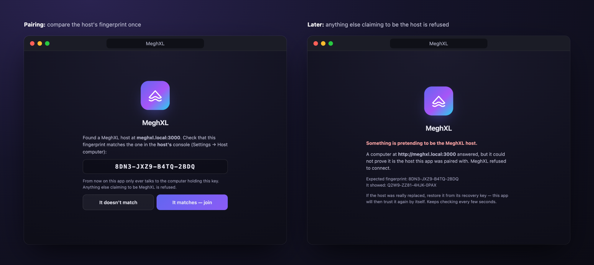
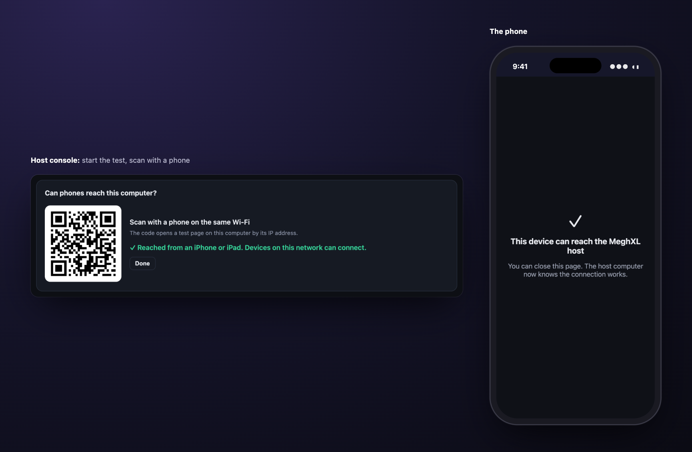

<p align="center">
  
</p>

<p align="center">
  <a href="https://github.com/riponcm/MeghXL/releases/latest"></a>
  <a href="https://github.com/riponcm/MeghXL/releases"></a>
  <a href="LICENSE"></a>
  <a href="https://github.com/riponcm/MeghXL/stargazers"></a>
</p>

<p align="center">
  <b>Transfer anything across your local network — instantly, privately, at any size.</b><br>
  Your team's own private transfer cloud. No accounts, no third-party cloud, no file-size limits.
</p>

https://github.com/user-attachments/assets/272ffbba-21cd-4f99-8cff-8ca0bc8d0811

<p align="center"><sub>51-second tour: a phone sends a 240 MB video to a PC on the same Wi-Fi — nothing installed on the phone.</sub></p>

<p align="center">
  <code>#file-transfer</code> &nbsp;<code>#self-hosted</code> &nbsp;<code>#local-network</code> &nbsp;<code>#intranet</code> &nbsp;<code>#zero-config</code> &nbsp;<code>#privacy-first</code>
</p>

---

## What is MeghXL?

**MeghXL is a free, open-source, self-hosted file transfer tool for your local
network** — an AirDrop and WeTransfer alternative that works on Windows, macOS,
Linux, Android and iOS without installing anything on the receiving device.

Run one command on a PC and MeghXL turns it into a private file-transfer hub for
your whole network. Drop a file in the dashboard and it instantly appears on every
connected device with a download button and a QR code. The receiving side needs
**nothing but a browser** — no app, no account, no sign-in.

It's built for **offices, teams, and large networks**: your files never leave your
network unless you explicitly choose to share them, and there are no per-file size
caps or cloud middlemen.

A [matily.org](https://matily.org/meghxl/) product. Free and open source under the
Apache 2.0 license.

<p align="center">
  <a href="https://github.com/riponcm/MeghXL/releases/download/v1.1.2/MeghXL_1.1.2_x64-setup.exe"></a>
  <a href="https://github.com/riponcm/MeghXL/releases/download/v1.1.2/MeghXL_1.1.2_aarch64.dmg"></a>
  <a href="https://github.com/riponcm/MeghXL/releases/download/v1.1.2/MeghXL_1.1.2_x64.dmg"></a>
  <a href="#linux"></a>
</p>

<p align="center"><sub>v1.1.2 · Signed and notarized · Free, no account · Not sure which Mac? Apple menu → About This Mac · <a href="https://github.com/riponcm/MeghXL/releases/tag/v1.1.2">Release notes</a> · <a href="#download">Install notes</a></sub></p>

## How MeghXL compares

|  | **MeghXL** | AirDrop | LocalSend | WeTransfer |
|---|:---:|:---:|:---:|:---:|
| Windows, Mac, Linux, Android **and** iPhone together | ✅ | ❌ Apple only | ✅ | ✅ |
| Phones and guests install **nothing** | ✅ any browser | ✅ built in | ❌ app needed to send | ✅ |
| Works with **no internet** | ✅ | ✅ | ✅ | ❌ |
| Files never leave your network | ✅ | ✅ | ✅ | ❌ uploaded to their cloud |
| No file-size limit | ✅ | ✅ | ✅ | ❌ capped by plan |
| **Shared board** — files wait for whoever needs them | ✅ | ❌ one-shot | ❌ one-shot | 🟡 a link, until it expires |
| **Resumes** after a phone locks or the Wi-Fi drops | ✅ | — | ❌ | — |
| **Host console** — devices, blocking, approvals, announcements | ✅ | ❌ | ❌ | 🟡 paid plans |
| **Private mode** for café, office and hotel Wi-Fi | ✅ QR or code | 🟡 contacts only | — | — |
| No account, free and open source | ✅ | 🟡 free, closed | ✅ | ❌ account + paid tiers |

<sub>✅ yes · ❌ no · 🟡 partly · — not something we could verify</sub>

**Only in MeghXL**

- **A board, not a beam.** Drop a file once and it's there for the whole team —
  no need for the other person to be online right then.
- **Your own hub, with an admin.** One computer hosts; the host console lets you
  see every device, block one, approve newcomers and post announcements.
- **Safe on shared Wi-Fi.** Private mode keeps strangers out; devices can't pose
  as each other or as the host; desktop apps check the host's signing key.
- **Disguised programs get caught.** A `photo.jpg` that's really a program is
  flagged before anyone saves it.
- **Big files from phones actually arrive.** Uploads pause when the screen locks
  and carry on where they stopped.

The trade-off, honestly: MeghXL is **hub-and-spoke**, not peer-to-peer — one
computer has to be on. In exchange, nobody else installs anything.

## Preview

<p align="center">
  <a href="assets/screenshots/dashboard.png"></a><br><b>The board.</b> Files from every device in one place — and a "PDF" that is really a Windows program, flagged before anyone opens it.
</p>

<p align="center">
  <a href="assets/screenshots/phones.png"></a><br><b>Phones need no app.</b> The same board in Safari — and when the Wi-Fi drops mid-upload, it pauses and carries on where it stopped.
</p>

<p align="center">
  <a href="assets/screenshots/warning.png"></a><br><b>Disguised programs get caught.</b> Saving one asks first.
</p>

<p align="center">
  <a href="assets/screenshots/console.png"></a><br><b>The host console.</b> A guest waits to be let in; every device at a glance.
</p>

<p align="center">
  <a href="assets/screenshots/private-mode.png"></a><br><b>Private mode</b> for shared Wi-Fi: join by QR code or a 6-digit code.
</p>

<p align="center">
  <a href="assets/screenshots/desktop-pairing.png"></a><br><b>One host, and it proves it.</b> Pair once; impostors are refused.
</p>

<p align="center">
  <a href="assets/screenshots/connection-test.png"></a><br><b>"Can phones reach this computer?"</b> One scan tells you — and what to change if not.
</p>

## Features

**Sharing**

- **Drag and drop** — or click, or paste from the clipboard — to share a file.
- **Live dashboard** — a public file dropped on one device appears on every other
  open dashboard within a second.
- **Public, private, or to one device** — public files appear on the shared
  board; private files only through their unguessable link or QR; a direct send
  goes straight to one device.
- **One-time links and auto-expiry** — a file that deletes itself after one
  download, or after a set time.
- **Any size, and interruptions are fine** — uploads go up in pieces and carry on
  where they stopped if a phone locks its screen or the Wi-Fi drops; downloads
  resume too.
- **Shared message board** — post a note to everyone, or a private message to one
  device: a clipboard for URLs, codes and Wi-Fi passwords.
- **Instant QR codes** for every file and for joining the board.

**Running the hub**

- **One host, and it proves it** — the desktop app on other computers pairs with
  the host once and refuses any other computer that claims to be MeghXL. A
  recovery key restores the host on new hardware; the host can be moved to
  another computer on purpose — never taken over.
- **Host console** — connected devices, files, announcements, blocking, settings
  and an activity log, on the host computer only.
- **Private mode for shared Wi-Fi** — in a café, office or hotel, devices join
  with the host's QR code or a 6-digit code first; optionally the host approves
  each new device and each name change.
- **Upload limits** — a largest-file size and a total storage budget for other
  devices, and a disk-space reserve so nobody can fill the host's drive.
- **"Can phones reach this computer?"** — a one-tap connection test that tells
  you what to change (Windows network set to Public, firewall) when a phone
  can't connect.
- **One name per computer** — Safari, Chrome and Firefox on the same Mac show up
  as one device, and a file sent to it reaches all of them.
- **Always on** — start at login, and the desktop app keeps the host from going
  to sleep while it hosts.
- **Friendly name** — reachable at `http://meghxl.local:3000`.

**Safety**

- **Program warnings** — apps, installers and scripts are labelled; a program
  disguised as a photo or PDF is called out, and saving one asks first. The
  desktop app marks received files so macOS and Windows check them before they
  open.
- **LAN-only by design** — MeghXL never exposes itself to the internet.
- **Signed apps and signed updates** — the Mac app is notarized by Apple, the
  Windows app is signed, and in-app updates install only packages signed with the
  project's key. MeghXL checks for updates only when you press the button.
- See [How secure is MeghXL?](#how-secure-is-meghxl) for the full picture.

**Small and readable** — a vanilla front-end with no build step, seven runtime
dependencies, and a single `node server.js`.

## Download

Install it on the computer that will be the **host**. Every other device just
opens a browser — or, on other computers, the same app joins the host.

| Your computer | Package | Download |
|---|---|---|
| **Windows** 10/11 — x64 | EXE installer (or MSI) | [Download for Windows](https://github.com/riponcm/MeghXL/releases/download/v1.1.2/MeghXL_1.1.2_x64-setup.exe) · [MSI](https://github.com/riponcm/MeghXL/releases/download/v1.1.2/MeghXL_1.1.2_x64_en-US.msi) |
| **Mac with Apple Silicon** (M1, M2, M3, M4…) | DMG | [Download for Apple Silicon](https://github.com/riponcm/MeghXL/releases/download/v1.1.2/MeghXL_1.1.2_aarch64.dmg) |
| **Mac with Intel** | DMG | [Download for Intel Mac](https://github.com/riponcm/MeghXL/releases/download/v1.1.2/MeghXL_1.1.2_x64.dmg) |
| **Linux** — x64 | DEB / RPM | [DEB](https://github.com/riponcm/MeghXL/releases/download/v1.1.2/MeghXL_1.1.2_amd64.deb) · [RPM](https://github.com/riponcm/MeghXL/releases/download/v1.1.2/MeghXL-1.1.2-1.x86_64.rpm) |

[Release notes](https://github.com/riponcm/MeghXL/releases/tag/v1.1.2) · [All releases](https://github.com/riponcm/MeghXL/releases)

Every installer is self-contained — the server is compiled in, so there is no
runtime to install (26–40 MB). Open it and the dashboard appears; a tray icon keeps
it running.

**Signed.** The Mac app is signed with an Apple Developer ID and notarized by Apple;
the Windows app, its server and both installers are signed through Azure Artifact
Signing. They open without "unidentified developer" warnings. (A newly signed
Windows publisher can still see a SmartScreen notice until enough people have
installed it.)

<a id="linux"></a>**Linux:** install the package for your distribution —

```bash
sudo apt install ./MeghXL_1.1.2_amd64.deb       # Debian, Ubuntu, Mint
sudo dnf install ./MeghXL-1.1.2-1.x86_64.rpm    # Fedora, RHEL, openSUSE (zypper)
```

> Used the 1.0.1 **AppImage**? Install the `.deb` or `.rpm` once; the in-app
> updater keeps it current from then on. (AppImage is paused: building one breaks
> the bundled server — [tauri#5189](https://github.com/tauri-apps/tauri/issues/5189).)

## How to use it

Three steps. Only **one** computer installs anything.

### 1. Pick one computer to be the hub

This is the machine everyone shares through — an office PC, a spare laptop, a
Mac in the corner. Install MeghXL on it from [Download](#download) above, open it,
and choose **This computer is the host**. That's the whole setup.

There is only ever **one** host. If MeghXL is installed on another computer too,
choose **Join the host** there: the app finds the host, shows its fingerprint to
compare with the host's screen, and from then on only ever talks to that host.

You'll see the dashboard, and the app shows the address other devices should use:

```
meghxl.local:3000
```

### 2. Open that address on any other device

Phones, laptops, tablets — **anything with a browser**, on the same Wi-Fi:

- **Scan the QR code** — click **Add a device** in the sidebar and point a phone
  camera at it. Fastest way, and no typing.
- **Or type** `meghxl.local:3000` into the browser.

> If a device can't open `meghxl.local` — some Android browsers don't resolve
> `.local` names — use the numeric address instead. It's in the host's tray menu
> under **Copy network link**, and on the host console under Settings.

Bookmark it once per device and it's one tap forever.

### 3. Drop a file

On any device, go to **Send**, drag a file in, choose who gets it, and press
**Send**:

| Send to | What happens |
|---|---|
| **Everyone** | Appears on every device's Dashboard, live |
| **Private link** | Only someone with the link can open it — it's in no list |
| **A specific device** | Goes straight to that one device's Private tab |

Before sending you can set an **expiry**, or tick **one-time** so the file deletes
itself the moment it's downloaded once.

That's it. Files download to each device normally; nothing else to install.

**Two things worth doing on the hub:**

- Turn on **Start at login** in the tray menu, so the hub is always ready.
- Open the **Host console** (visible only on the hub) to see connected devices,
  post an announcement, or clear old files.
- In **Host console → Settings → Host computer**, save the **recovery key**
  somewhere safe. If the hub's computer ever dies, it makes a new one the same
  host.
- On shared Wi-Fi (office, café), turn on **private mode** in the same Settings.

## Quickstart (from source)

Prefer a terminal, or running it on a headless box or NAS? Requires **Node.js 18+**.

```bash
git clone https://github.com/riponcm/MeghXL.git
cd MeghXL
npm install
npm start
```

The terminal prints your network URL and a scannable QR code:

```
  +---------------------------------------------+
  |  MeghXL is running                          |
  |                                             |
  |  On this computer:  http://localhost:3000   |
  |  On your network:   http://192.168.x.x:3000 |
  |  Friendly name:     http://meghxl.local:3000|
  |                                             |
  |  Scan to open on your phone:  [QR code]     |
  +---------------------------------------------+
```

On any other device on the **same network**, scan the QR (or open
`http://<your-ip>:3000`, or `http://meghxl.local:3000`) and the dashboard loads.
Drop a file on one device, grab it on another.

> On macOS the first run may show a firewall prompt — click **Allow** so other
> devices can reach the port.

## How it works

1. The server binds to `0.0.0.0` so every device on your LAN can reach it, and
   auto-detects your IPv4 to build shareable links.
2. Uploads arrive in pieces (so they can resume) and are stored in `uploads/` under
   a random filename; the original name, size, type, and a random **token** are
   recorded in `metadata.json`.
3. The token is the access control: `GET /d/<token>` serves the file. Public files
   are also listed on the dashboard; private files never appear in any list.
4. A WebSocket fans out `file-added` / `file-removed` / `note-added` events so
   every dashboard stays live.

## Configuration

All optional — set as environment variables (for example, `PORT=8080 npm start`):

| Variable | Default | Purpose |
|---|---|---|
| `PORT` | `3000` | Port to listen on |
| `MAX_UPLOAD_MB` | _(unlimited)_ | Cap upload size in MB; unset or `0` = no limit |
| `MIN_FREE_MB` | `5120` | Refuse uploads that would leave less than this much free disk space (MB) |
| `UPLOAD_DIR` | `./uploads` | Where files are stored |
| `DATA_FILE` | `./metadata.json` | Metadata store path |
| `PUBLIC_BASE_URL` | _(unset)_ | Override the base URL for all links and QRs |
| `MDNS_NAME` | `meghxl` | The `<name>.local` mDNS hostname to advertise |
| `MDNS` | _(on)_ | Set to `off` to disable mDNS advertising |
| `ADMIN_IP` | _(unset)_ | Extra PC(s), by LAN IP, that get the host console |
| `ADMIN_KEY` | _(auto-generated)_ | Key for admin from another device; a random one is generated and printed at startup if unset |
| `ALLOWED_HOSTS` | _(unset)_ | Extra host names you reach MeghXL by (comma-separated) — e.g. a proxy's public domain or a Tailscale `*.ts.net` name. IP addresses and local names (`.local`, `.lan`, …) work without it |

## Host console

MeghXL has a private control panel at **`/admin`**:

- On the **computer running the server**, it opens automatically — no key, no
  login. Every browser on that machine is admin (works via `localhost`, the LAN
  IP, or `meghxl.local`), so don't run MeghXL on a PC shared with people you
  don't trust.
- **Every other device** on the network just sees the normal dashboard — to
  reach the console it needs `ADMIN_IP` or the admin key.
- Need admin from a different PC? Designate it by LAN IP with `ADMIN_IP=...`, or
  enter the admin key (printed in the terminal at startup) on the console's
  unlock form.

Scripting the admin API — send the key as a header, plus `x-meghxl-request` on
anything that changes state:

```bash
curl -H "x-admin-key: $KEY" http://hub:3000/api/admin/state
curl -X POST -H "x-admin-key: $KEY" -H "x-meghxl-request: 1" \
     -H "Content-Type: application/json" -d '{"text":"Back at 6pm"}' \
     http://hub:3000/api/admin/announce
```

From the console you can:

- **Devices** — see who is connected, send a file, block or unblock, and let in
  devices or name changes waiting for approval.
- **Files** and **announcements** — manage every file, broadcast a banner.
- **Activity** — joins, approvals, renames, blocks, refused uploads, wrong codes.
- **Settings** — private mode and its join code, approvals, upload limits,
  refusing programs, default expiry, the connection test, a diagnostic report for
  bug reports, and the **host computer**: its fingerprint, recovery key, settings
  backup, and moving the host to another computer.

Everything persists across restarts.

## Remote access (advanced)

**MeghXL is LAN-only by design and never exposes itself to the internet** — there
is no "go public" button. Keeping internet exposure out of the app is a deliberate
security choice for an internal tool.

If you genuinely need access from outside your network, do it the safe way: put
MeghXL behind infrastructure **you** control and authenticate — a **VPN**
(WireGuard / Tailscale) or an **authenticated reverse proxy** — then point links
and QR codes at that address:

```bash
PUBLIC_BASE_URL=https://meghxl.your-company.com npm start
```

MeghXL refuses host names it doesn't recognise, which is what stops DNS-rebinding
attacks. IP addresses and local names (`.local`, `.lan`, single-label names) work
out of the box; the `PUBLIC_BASE_URL` host is added automatically. Reaching it by
any other name — a Tailscale `*.ts.net` name, say — needs that name in
`ALLOWED_HOSTS`. Behind a reverse proxy, have it **preserve the `Host` header** and
send `X-Forwarded-For`.

> Whatever you expose it through, add authentication at that layer. On the LAN
> itself, treat the network as trusted and use **private + expiry + one-time**
> links for anything sensitive.

## Always-on "mother PC"

Make one PC the always-on hub so the others just click their bookmark:

```bash
npm run autostart:install     # macOS: starts now, and on every login
npm run autostart:uninstall   # remove it
```

(macOS/launchd today; the script is a small template you can mirror with
`systemd --user` on Linux or the Startup folder on Windows.)

## Desktop app

MeghXL also ships as a real native app — a **Tauri** shell around the same
server, so the machine hosting it needs **no Node.js installation and no
terminal**. Double-click, and the dashboard opens in its own window.

```bash
cd desktop
npm install
npm run build        # → desktop/src-tauri/target/release/bundle/
```

You get `MeghXL.app` and a `.dmg` on macOS, an `.msi` / NSIS installer on
Windows, and `.deb` / `.rpm` on Linux. Downloads are 26–40 MB — the server is
compiled into a single executable with `bun build --compile` and bundled as a
Tauri sidecar, so there is no runtime to install.

What the app adds over `npm start`:

- **Host or join** — on first launch, choose whether this computer is the host or
  joins the host. A joining computer runs no server; it pairs with the host's key
  and refuses anything else claiming to be MeghXL, showing a warning instead.
- **Keeps the host awake** while it hosts (can be turned off in the menu).
- **Saves downloads safely** — to the folder you choose, marked as downloaded so
  macOS and Windows check them before they open.

- **Tray icon** — open the dashboard or host console, copy the network link, or
  toggle **Start at login**. Closing the window parks MeghXL in the tray; the
  server keeps serving your other devices.
- **Cross-platform autostart**, replacing the macOS-only `autostart:install`
  script.
- **Attaches instead of colliding** — if a MeghXL server is already running on
  port 3000 (from the terminal or the autostart agent), the app uses it rather
  than starting a second one, and never stops a server it did not start.
- **Files stored outside the bundle** — transfers and metadata live in your
  user data directory, so they survive app updates.

Building it needs [Rust](https://rustup.rs) and [Bun](https://bun.sh) (plus
Xcode Command Line Tools on macOS). Tauri cannot cross-compile between macOS and
Windows — build each on its own machine, or use a CI matrix.

> Your own local builds are unsigned, so macOS and Windows warn on first launch;
> the released binaries are signed (see above).

## Roadmap

Done recently:

- [x] **Native desktop app** for macOS, Windows and Linux, with a tray icon
- [x] **Signed and notarized releases** (Apple notarization, Windows signing)
- [x] **Security hardening** — private mode, approvals, device identity, limits
- [x] **One host with a verifiable identity**, recovery key and planned moves
- [x] **Resumable uploads** that survive a phone locking its screen
- [x] **One name per computer** — a machine's browsers grouped as one device
- [x] **Connection test** and diagnostic report

Next:

- [ ] **Android and iOS apps**, with share-sheet sending — and host verification on phones
- [ ] **HTTPS on the LAN** with your own certificate, for networks you don't trust
- [ ] **End-to-end encryption** for private transfers
- [ ] **Optional auth layer** for `PUBLIC_BASE_URL` deployments (password / SSO)
- [ ] **AppImage** again, once Tauri can package the server without breaking it
- [ ] **Multi-language UI** — English, বাংলা (Bengali), हिन्दी (Hindi), and more
- [ ] **Themes** — light, dark, and custom accent colors

Want a say in what ships next? **Watch → Custom → Releases** and open an issue with your request.

## Support the project

If MeghXL saves you time, a star genuinely helps it reach more people — and
**Watch → Releases** is the easiest way to hear the moment the **mobile apps**
drop.

<p align="center">
  <a href="https://github.com/riponcm/MeghXL/stargazers"></a>
  &nbsp;
  <a href="https://github.com/riponcm/MeghXL/watchers"></a>
  &nbsp;
  <a href="https://github.com/riponcm/MeghXL/network/members"></a>
  &nbsp;
  <a href="https://github.com/riponcm/MeghXL/releases"></a>
</p>

The 51-second tour at the top shows the basics; a full **video tutorial is coming
soon**. Sharing MeghXL with your team is the best thanks.

## Updates and privacy

MeghXL contacts the internet only when you press **Check for updates** — in the
About page, the desktop app's menu bar menu or its tray icon. Nothing runs on a
timer or at launch, and no request carries identifiers, filenames or usage data.

- **In a browser**, the hub makes a single `GET` to the GitHub releases API to
  compare version numbers; the answer is cached for an hour.
- **In the desktop app**, the app fetches the release manifest from GitHub, shows
  you what's new, and downloads the package only if you click **Install**.

Desktop updates are **signature-verified** — the app installs only a package
signed with the project's key, checked against the public key compiled into the
bundle, so a compromised download cannot push you malicious code.

Don't want the browser check at all? Delete `src/routes/update.js` and its
`app.use` line in `server.js`. Nothing else depends on it.

## How secure is MeghXL?

Short answer: **built to be safe on a network with strangers on it, honest about
what it can't do, and checked by people trying to break it.**

**How it was tested.** Before 1.1.0, the hub went through a four-way security
review — a code audit, a threat model, a look at disguised-malware tricks, and a
live attack run against a real server — then an independent review of the fixes.
Every attack found became a test: the suite has nearly a hundred, including
crashing the server, impersonating a device, sneaking past private mode, hiding a
program in a zip, and overrunning the disk. Vulnerabilities are disclosed
publicly in [security advisories](https://github.com/riponcm/MeghXL/security/advisories).

**What it protects against:**

| If someone tries to… | What stops them |
|---|---|
| Reach the hub from the internet | It never exposes itself; unknown host names are refused (DNS rebinding) |
| Use a website on the host PC to control it | Cross-site requests, framing and cross-site WebSockets are refused |
| Get into the host console | Only the host computer, an `ADMIN_IP`, or the admin key — wrong keys are throttled |
| Join a private hub | Private mode: the host's QR code or 6-digit code; optional approval of each device |
| Pretend to be another device | Device ids are secret; others only see a stand-in that can't be used to impersonate |
| Pretend to be the host | Host-like names are marked; desktop apps check the host's signing key; the host alerts on impostors |
| Delete someone else's files | Only the device that shared it, or the host |
| Keep going after being blocked | A block covers every request, not just the live connection |
| Crash the hub or fill its disk | Message size caps, rate limits, connection caps, upload limits, a disk reserve |
| Disguise a program as a photo | Real extension always shown; content checked; a warning before saving; optional refusal |
| Read a private file | 128-bit unguessable links; files are never listed |
| Tamper with an update | Updates install only if signed with the project's key |

**What it doesn't do — stated plainly:** traffic on the LAN is plain HTTP (not
encrypted), so someone able to intercept your network could read transfers; a
phone's browser can't verify the host's identity the way the desktop app can; and
MeghXL doesn't scan files for malware — it says what a file *is*, never that it's
safe. On a network you don't control, use private mode and keep sensitive files
to private, expiring links.

Full details: **[SECURITY.md](./SECURITY.md)** — the threat model, how to report a
vulnerability, and a 10-minute checklist to audit the code yourself (no
telemetry, no install scripts, no dynamic code execution).

## Development

```bash
npm run dev     # auto-restart on changes (node --watch)
npm test        # run the test suite (node --test)
```

Project layout:

```
server.js          entry — wires Express + WebSocket on one port
src/               config, networking, store, uploads, qr, ws hub, routes
public/            the no-build dashboard (HTML/CSS/JS)
desktop/           native app — Tauri shell + the server as a sidecar binary
assets/            brand assets (logo, hero, previews)
uploads/           runtime file storage (git-ignored)
```

## FAQ

### How do I transfer files between two computers on the same Wi-Fi?

Run MeghXL on one of them (`npm start`, or open the desktop app). It prints a URL
and a QR code. On the other computer, open that URL in any browser and drag your
file onto the page — it appears on the first machine immediately.

### Is there an AirDrop alternative that works between Windows, Mac and Android?

Yes — this is one. AirDrop only works between Apple devices. MeghXL works between
anything with a browser, so a Windows PC, a Mac, an Android phone and an iPhone can
all share the same board at once.

### Does it work without an internet connection?

Yes. MeghXL only needs the devices to be on the same Wi-Fi or LAN. Nothing is
uploaded to any cloud, and no account or sign-in exists.

### How do I send a large file — 1 GB, 10 GB, more?

There is no size limit beyond your disk (unless the host sets one). Uploads go up in
pieces and pick up where they stopped after an interruption, and downloads
support HTTP Range, so they resume rather than restarting.

### Can I share a file with just one person instead of everyone?

Yes. Send it as a **private** link, or straight to a single device from the Send
screen. Private files never appear on anyone else's dashboard. Add an **expiry** or
make it a **one-time link** that deletes itself after a single download.

### Is it safe to use at the office?

Yes, with the right settings. Turn on **private mode** so only people with the
host's QR code or join code get in, and optionally **approve each new device**.
Devices can't impersonate each other or delete each other's files, blocked
devices are locked out completely, and programs are flagged before anyone saves
them. Traffic isn't encrypted on the LAN, so on a network you don't trust, keep
sensitive files to private, expiring links. See
[How secure is MeghXL?](#how-secure-is-meghxl).

### Do I need to install anything on phones?

No. Phones just scan the QR code and use their browser. Only the computer acting as
the hub runs MeghXL.

### Can I use it over the internet?

Not directly, and that is deliberate — MeghXL never exposes itself to the internet.
Put it behind your own VPN or an authenticated reverse proxy and set
`PUBLIC_BASE_URL`. See [Remote access](#remote-access-advanced).

## Contributing

Issues and pull requests are welcome. The codebase is intentionally small and
dependency-light — read `server.js` and `src/` and you will have the whole picture
in a few minutes.

Start with **[CONTRIBUTING.md](./CONTRIBUTING.md)** — it covers setup and, more
importantly, the design constraints that are load-bearing (LAN-only, no build step,
no telemetry, the receiver installs nothing). Release history lives in
**[CHANGELOG.md](./CHANGELOG.md)**.

## Credits

**MeghXL** is another open-source project from **Matily** — built with care on
Node.js and Express, with a vanilla, build-free front-end.

Development memory was kept with **[projectmem](https://github.com/riponcm/projectmem)**
([projectmem.dev](https://projectmem.dev)) — local-first memory for AI coding
agents, which recorded the decisions, gotchas and failed approaches behind this
codebase so they were not repeated.

If MeghXL is useful to you, please **star and share** the repo. Contributions,
issues, and ideas are always welcome.

## License

[Apache License 2.0](./LICENSE) — free to use, fork, modify and ship, including
commercially. It adds an explicit patent grant and asks that you keep the notices
in [NOTICE](./NOTICE) and state any changes you make.
